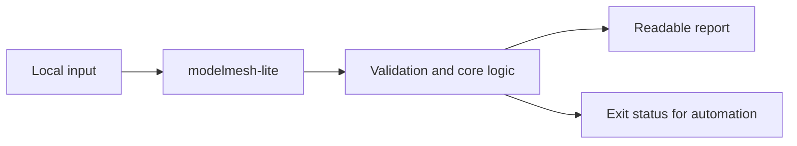

# modelmesh-lite

<div align="center">
  
  <br/>
  
  
  
</div>

> A small OpenAI-compatible model router with task-based provider selection and explicit fallback order.

## Why it exists

A focused, inspectable starter for a real developer workflow. It favors explicit behavior, local execution, and small pieces that are easy to understand and extend.

## Features

- Route tasks to named OpenAI-compatible endpoints
- Read API keys only from environment variables
- Try configured fallbacks in a deterministic order
- Print provider and model metadata without logging prompts

## Architecture



## Requirements

- Python 3.10+ / standard library
- A terminal and a local checkout of this repository

## Quick start

```bash
python src/modelmesh.py --config examples/providers.json --task code --prompt 'Explain a Python dataclass'
```

## Example

```bash
MODEL_A_KEY=your-key python src/modelmesh.py --config examples/providers.json --task fast --prompt 'Summarize this error'
```

## Project status and limitations

This repository contains an initial working implementation, not a production-certified product. Review the source and test it against your own fixtures before adopting it in critical workflows.

The router sends your prompt to the selected third-party endpoint. Review provider retention and privacy policies, and never place secrets inside prompts. The sample config uses placeholder URLs and must be edited.

## Roadmap

- [ ] Add per-provider timeout budgets
- [ ] Add local-only provider adapters
- [ ] Add optional latency and cost history

## Contributing

Issues and pull requests are welcome. Please include a small reproducible example for bug reports, keep changes focused, and add tests for new behavior. Do not submit secrets, private data, or generated artifacts.

## License

MIT. See [LICENSE](LICENSE). Third-party services or optional dependencies remain subject to their own terms.
